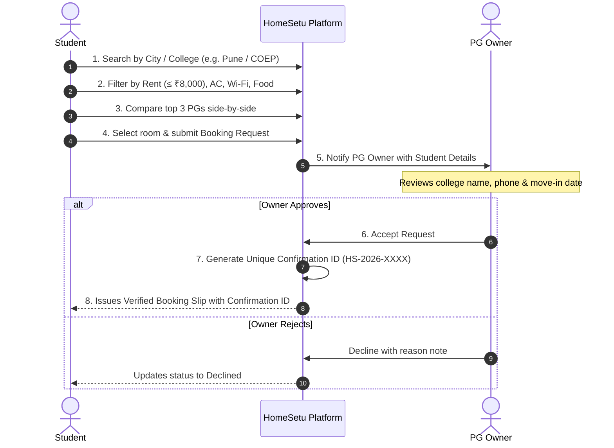

# 🏠 HomeSetu — Connecting Students with the Right Place to Stay

[](https://react.dev/)
[](https://spring.io/projects/spring-boot)
[](https://www.oracle.com/java/)
[](https://tailwindcss.com/)
[](https://www.mysql.com/)
[](https://vitejs.dev/)

> **A Student-Centric PG Discovery & Booking Platform**  
> Direct connections between students and PG owners with **zero middlemen**, **complete transparency**, **side-by-side PG comparison**, and **verifiable Confirmation IDs**.

---

## 👥 Project Team — ByteBros

| Member Name | Role | Email |
| :--- | :--- | :--- |
| **Aryan Gupta** | Team Lead & Full-Stack Developer | `aryanguptaji686@gmail.com` |
| **Arsh Mittal** | Backend & System Architecture | `arshm2772@gmail.com` |
| **Archana** | Frontend & UI/UX Design | `archanabayee@gmail.com` |

---

## 🎯 Problem Statement & Motivation

Moving to a new city for higher education starts with one crucial question: **"Where will I stay?"**

1. **New City & College**: Lack of reliable, centralized PG information in student hubs (Pune, Bengaluru, Delhi, Kota).
2. **Broker Exploitation**: Heavy dependence on unverified brokers demanding 1-2 months of unnecessary brokerage fees.
3. **Hard to Compare**: Difficulty evaluating rent, hidden electricity rules, food inclusions, and college commute distance.
4. **Wasted Physical Visits**: Misleading listings and uncertainty about real-time room availability.
5. **Time & Security Risk**: Informal chats and fake listings with zero booking protection.

---

## 🚀 HomeSetu Objectives

* **No Brokers, No Middlemen**: Students connect directly with verified PG owners (0% commission).
* **Easy & Fast for Students**: Search, filter, and compare accommodations in minutes instead of days of physical visits.
* **Complete Transparency**: Clear rent breakdown, security deposit, meal menus, and gate rules upfront.
* **Safe & Verified Stays**: Photo-verified properties and verified owner credentials.
* **Structured Booking Flow**: Formal `Search ➔ Filter ➔ Compare ➔ Request ➔ Owner Review ➔ Confirmation ID` lifecycle.
* **Affordable & Convenient**: Budget-oriented filters suited to student financial constraints.

---

## 🔄 System Architecture & User Journey



> ⚠️ **Core Architectural Rule**: The **Confirmation ID** is generated **strictly after** the PG owner reviews the student profile and clicks **Accept**.

---

## ✨ Key Features

| Feature | Description |
| :--- | :--- |
| **Smart Search** | Search by student hub cities (Pune, Bengaluru, Delhi, Kota, Mumbai), localities, and landmark colleges (COEP, MIT, Symbiosis, Christ, DU). |
| **Advanced Filters** | Real-time filtering by max rent budget, room sharing (Single/Double/Triple), gender type (Boys/Girls/Co-ed), AC, Wi-Fi, Meals, and Verified stays. |
| **Side-by-Side PG Comparison** | Compare up to 3 PGs simultaneously across 12+ parameters (rent, deposit, amenities, food, gate timing, rules). |
| **Live Bed Availability** | Live tracking of vacant beds and room types per property. |
| **Structured Booking Flow** | Formal application containing move-in date, stay duration, and student college details. |
| **Unique Confirmation ID** | Tamper-proof, cryptographically randomized booking code (e.g., `HS-2026-7842`) generated upon owner approval. |
| **Official Booking Slip** | Downloadable / printable digital voucher with student, owner, and check-in information. |
| **Verified Listings Badge** | Trust badge granted to verified properties and authentic owners. |
| **Student Reviews & Ratings** | Star ratings and reviews covering cleanliness, food quality, and amenities. |
| **Student Dashboard** | Track pending applications, view accepted vouchers, and download slips. |
| **PG Owner Dashboard** | Manage listings, review incoming applications, accept/reject requests, and track property occupancy. |
| **Admin Portal** | Platform statistics and one-click listing verification management. |

---

## 🛠️ Technology Stack

* **Frontend**:
  * [React.js](https://react.dev/) (HTML5, Modern ES6+ JavaScript)
  * [Vite 8](https://vitejs.dev/) (Lightning fast development & optimized build)
  * [Tailwind CSS v4](https://tailwindcss.com/) (Responsive, deep teal & amber branding)
  * [Lucide React](https://lucide.dev/) (Clean iconography)
* **Backend**:
  * [Spring Boot 3.2](https://spring.io/projects/spring-boot) (Java 17 RESTful APIs)
  * [Spring Data JPA](https://spring.io/projects/spring-data-jpa) & [Hibernate](https://hibernate.org/) (ORM & persistence)
  * [Jakarta Bean Validation](https://beanvalidation.org/) (Request validation)
* **Databases**:
  * **H2 In-Memory Database** (Default profile for 1-click zero-configuration testing & evaluations)
  * **MySQL 8.0** (Production persistence profile: `application-mysql.properties`)

---

## 🚀 Quick Start Guide

### Prerequisites
* **Java 17+** (JDK 17)
* **Node.js 18+** & npm
* **Apache Maven 3.9+** (or use system maven)
* *(Optional)* MySQL 8.0 running on port 3306

---

### Option 1: 1-Click Startup (Windows)
Double-click:
```bash
run-all.bat
```
This automatically launches the Spring Boot backend on port `8088` and the Vite React frontend on port `5173`.

---

### Option 2: Manual Terminal Startup

#### 1. Backend (Spring Boot):
```bash
cd backend
mvn spring-boot:run
```
* Backend API starts at: `http://localhost:8088/api`
* Embedded H2 Console: `http://localhost:8088/h2-console`
* *(To switch to MySQL)*:
  ```bash
  mvn spring-boot:run -Dspring-boot.run.profiles=mysql
  ```

#### 2. Frontend (React + Vite):
```bash
cd frontend
npm install
npm run dev
```
* Open your browser at: `http://localhost:5173`

---

## 🔑 Demo Test Accounts

The platform comes pre-seeded with rich sample listings (Sunrise PG, Green Nest PG, Urban Stay) and role-based test users:

| Persona | Name | Email | Password | Role |
| :--- | :--- | :--- | :--- | :--- |
| **Student (COEP Pune)** | Aryan Gupta | `aryan@homesetu.com` | `123456` | `STUDENT` |
| **Student (Symbiosis)** | Arsh Mittal | `arsh@homesetu.com` | `123456` | `STUDENT` |
| **PG Owner (Kothrud)** | Ramesh Kothrud | `ramesh@pgowner.com` | `123456` | `OWNER` |
| **PG Owner (Baner)** | Sunita Patil | `sunita@pgowner.com` | `123456` | `OWNER` |
| **Platform Admin** | Admin | `admin@homesetu.com` | `admin123` | `ADMIN` |

> 💡 *Tip: You can switch between demo personas instantly in the Navbar user menu!*

---

## 📡 REST API Reference

| Method | Endpoint | Description |
| :--- | :--- | :--- |
| `POST` | `/api/auth/login` | User authentication |
| `POST` | `/api/auth/register` | Student or Owner registration |
| `GET` | `/api/pgs` | Search and filter PG listings |
| `GET` | `/api/pgs/{id}` | Detailed PG profile |
| `GET` | `/api/pgs/{id}/rooms` | Room configurations and bed counts |
| `POST` | `/api/pgs` | Create new PG listing (Owner) |
| `PATCH` | `/api/pgs/{id}/verify` | Toggle listing verification (Admin) |
| `POST` | `/api/bookings` | Submit student booking request |
| `GET` | `/api/bookings/student/{id}` | Fetch student's booking requests |
| `GET` | `/api/bookings/owner/{id}` | Fetch incoming requests for owner |
| `POST` | `/api/bookings/{id}/action` | Owner Accept/Reject (Generates Confirmation ID) |
| `GET` | `/api/bookings/confirmation/{id}` | Lookup booking by Confirmation ID |
| `GET` | `/api/reviews/pg/{pgId}` | Fetch student reviews for a PG |
| `POST` | `/api/reviews` | Submit new student review |
| `GET` | `/api/admin/stats` | Platform statistics |

---

## 🔮 Future Roadmap (Slide 9)

- [ ] AI preference-based PG recommendation engine
- [ ] Government ID & DigiLocker verification for hosts
- [ ] Real-time student-to-owner messaging & chat
- [ ] Interactive Map commute & distance calculator
- [ ] Advanced analytics dashboard for universities & college hostels

---

## 📤 Pushing to Your GitHub Repository

To push this project to your GitHub account:

1. Create a new repository on [GitHub](https://github.com/new) named `homesetu`.
2. Run the following commands in the project root:

```bash
git init
git add .
git commit -m "feat: complete HomeSetu full-stack platform (React + Spring Boot)"
git branch -M main
git remote add origin https://github.com/<YOUR_GITHUB_USERNAME>/homesetu.git
git push -u origin main
```

---

## 📄 License
This project is open-source and created for academic and presentation purposes by **Team ByteBros**.
